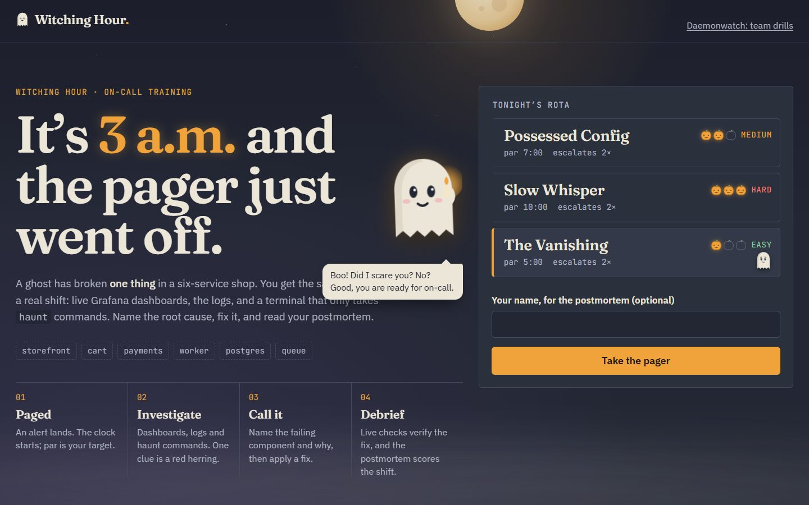
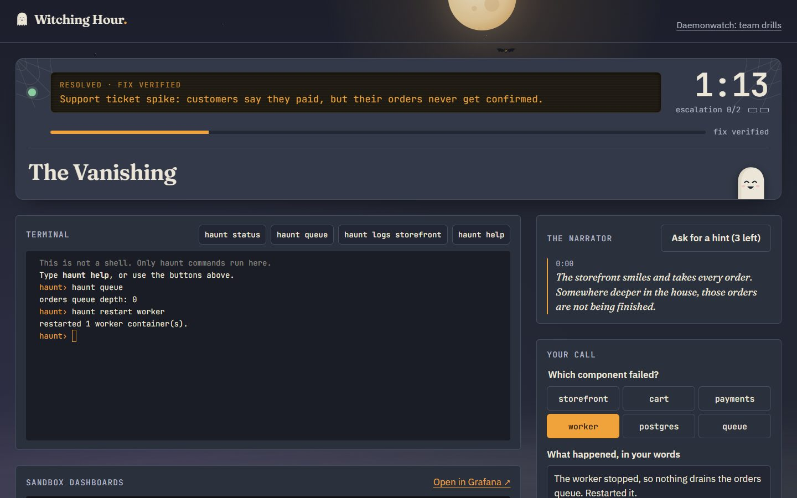
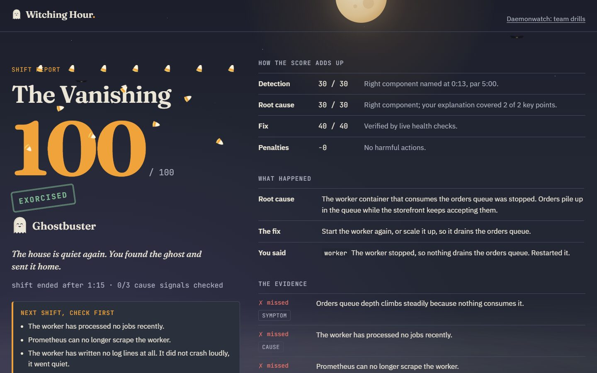

# Chaos Coven: Witching Hour

**An on-call training game.** AI "ghost" agents inject realistic production faults into a sandboxed microservice system. You get paged, investigate with real tools (Grafana, logs, a restricted terminal), name the root cause, apply a fix, and get a scored postmortem.

Most engineers do their first on-call shift without any practice. Witching Hour lets you practice on a system that is actually broken, where getting it wrong costs nothing.



**Play it:** <https://chaos-coven.eastasia.cloudapp.azure.com>. No sign-up and no password. It runs 24/7 on one small Azure VM. There is one sandbox, so one player at a time: if someone else is on call, the page tells you when it frees up (a shift takes about 5 to 10 minutes).

<table>
<tr>
<td width="50%"></td>
<td width="50%"></td>
</tr>
<tr>
<td>The pager, the terminal and your call. The ghost in the corner worries, panics when the haunting escalates, and cheers when your fix verifies.</td>
<td>The postmortem: score, rank, what you found and missed, and what to check first next shift. A Ghostbuster shift earns candy corn.</td>
</tr>
</table>

## How a haunting plays out

1. **Haunt.** A ghost injects a fault into the sandboxed shop.
2. **Page.** You get an alert, like a real page.
3. **Investigate.** Grafana dashboards, logs in Loki, and allowlisted `haunt` terminal commands.
4. **Name the root cause.** Which component failed, and why.
5. **Fix.** The fix only counts once live Prometheus and Loki checks confirm it.
6. **Postmortem.** A deterministic score (time to detect, root cause, verified fix, penalties for harmful actions), plus the evidence you found and missed and a full timeline.

**Daemonwatch**, a Kiro Crew App, lets a team lead schedule the same drill for a whole team and compare results.

## Who it's for

- Engineers new to on-call who want practice before their first rotation
- Students who have never debugged a distributed system under pressure
- Engineering managers running drills for their team

## Hauntings

| Haunting | Difficulty | What breaks |
|---|---|---|
| [The Vanishing](hauntings/the-vanishing.yaml) | easy | The worker consuming the orders queue stops silently. The storefront stays green while orders pile up. |
| [Possessed Config](hauntings/possessed-config.yaml) | medium | Payments' DB pool is set to 1, and the value is stored in Postgres, so restarting doesn't help. Then retries pile on. |
| [Slow Whisper](hauntings/slow-whisper.yaml) | hard | Cart leaks memory slowly; later, GC pauses stall every request. |

Each haunting is a YAML file validated against [`hauntings/schema.json`](hauntings/schema.json). It defines the fault, how it escalates, the signals a player can find (including a red herring), the health checks that prove a fix, the root cause, the fix, and which actions are harmful.

## Quick start

You need Node.js 20+ and Docker.

```bash
npm install
npm run build              # engine, server, both UIs, sandbox services
npm run sandbox:up         # the shop + Toxiproxy, Prometheus, Loki, Grafana
npm run sandbox:status     # wait for "sandbox: healthy"
npm run dev:server         # game server on http://127.0.0.1:4000
```

Then open **http://127.0.0.1:4000**, pick a haunting, and start your shift. Daemonwatch is at **http://127.0.0.1:4000/daemonwatch/**, and Grafana at **http://127.0.0.1:4000/grafana/** (the game server proxies it, so it works on one hostname).

To add Daemonwatch to a running Kiro Crew, see [crew-app/README.md](crew-app/README.md) (`POST /api/apps/install {"source": "./crew-app"}`).

To work on the UIs with hot reload, run `npm run dev:web` (port 5173) or `npm run dev:daemonwatch` (port 5174) alongside the server.

When you're done: `npm run sandbox:down`.

### Hosting it

The game drives a Docker sandbox, so it can't run on static hosting like Cloudflare Pages or Workers. It runs on one machine with Docker:

| Option | Address | Guide |
|---|---|---|
| **24/7 with your PC off** (what the live demo uses) | One permanent HTTPS address: a small Azure VM (works with Azure for Students), Caddy with a free Let's Encrypt certificate, only ports 80 and 443 open | [infra/azure/README.md](infra/azure/README.md) |
| Quick share from your PC | `npm run host:quick` opens a temporary `*.trycloudflare.com` link and prints a random access code | [infra/cloudflare/README.md](infra/cloudflare/README.md) |
| Your own domain | A named Cloudflare Tunnel with Cloudflare Access, using `npm run start:hosted` | [infra/cloudflare/README.md](infra/cloudflare/README.md) |

### Settings

Copy [`.env.example`](.env.example) and adjust. The useful ones:

| Variable | What it does |
|---|---|
| `WH_TIME_SCALE` | Speeds up escalation. `10` runs a 10-minute haunting in 1 minute. |
| `WH_NARRATOR` | `static` (default) uses the hand-written lines. `bedrock` rewrites them with Claude on Amazon Bedrock. |
| `AWS_REGION`, `WH_BEDROCK_MODEL_ID` | Bedrock region and model (default `anthropic.claude-opus-5-5`). Credentials come from the AWS credential chain, such as an IAM role. Never put keys in code or `.env`. |
| `WH_SESSION_MAX_MINUTES` | Sessions end and revert on their own after this long (default 45). |
| `WH_SESSION_IDLE_MINUTES` | Ends a shift when its page stops checking in for this long, such as a closed tab (default off; 5 when hosted). |
| `WH_ACCESS_CODE` | Optional. When set, every page asks for this code (at least 8 characters). Set it in the environment or a root-only file, never in the repo. The live demo doesn't use one. |

## The player terminal

The terminal is not a shell. Only these commands run, and the server checks every argument:

```
haunt status                          haunt restart <service>
haunt logs <service> [minutes]        haunt scale worker <1-3>
haunt grep <service> <word> [minutes] haunt config get <service> <key>
haunt promql <expression>             haunt config set <service> <key> <value>
haunt queue                           haunt purge-queue orders
haunt help
```

Some of these are traps. Purging the orders queue, for example, deletes orders customers already paid for, and the postmortem explains why it cost you points.

## Architecture

```
 Player UI (web/) ──┐                         ┌── Daemonwatch UI (crew-app/ui/)
                    ▼                         ▼
              Game server (server/) ── sessions, terminal, scoring, drills, narrator ──▶ Bedrock (optional)
                    │
                    ▼
              Engine (engine/) ── apply / escalate / verify / revert ◀── MCP tools for Kiro agents
                    │
        ┌───────────┼──────────────┬───────────────┐
        ▼           ▼              ▼               ▼
    Toxiproxy   Docker CLI    service admin   Prometheus / Loki
        └───────────┴──── sandbox (Docker Compose) ┘
```

| Part | What it is |
|---|---|
| [`engine/`](engine/) | Loads hauntings and applies, escalates, verifies and reverts them. A ledger records each resource's original state, so reverts work in any order, even with overlapping hauntings, and survive a crash. Also an MCP server (`list_hauntings`, `apply_haunting`, `escalate_haunting`, `verify_haunting`, `revert_haunting`, `revert_all_hauntings`, `haunting_signals`). |
| [`sandbox/`](sandbox/) | The haunted shop (storefront, cart, payments, worker, a traffic generator) with Postgres, a Redis queue, Toxiproxy between every hop, Prometheus, Loki and a provisioned Grafana dashboard. |
| [`server/`](server/) | Game API and WebSocket terminal, sessions with escalation timers, the narrator, postmortems, and the drills API for Daemonwatch. |
| [`web/`](web/) | The player UI: page, narration, embedded Grafana, xterm.js terminal, diagnosis, verify, postmortem. |
| [`crew-app/`](crew-app/) | Daemonwatch, a self-contained Kiro Crew App: manifest, Ghost Director and Medium agents, skills, a weekday drill cron, the dashboard page (plus the standalone page) and a signed-proxy backend. Its agents use the engine's MCP tools over HTTP at `/mcp` on the game server (loopback only). |
| [`.kiro/`](.kiro/) | Steering, the haunting-engine spec, hooks, agents and MCP settings. |
| [`docs/`](docs/) | [Writeup](docs/writeup.md), [playtest plan](docs/playtests.md), [Kiro journal](docs/kiro-journal.md). |

## Safety

From [`sandbox-safety.md`](.kiro/steering/sandbox-safety.md), enforced in code:

- **Every fault is reversible.** Ending a session, a timeout, a server shutdown or a crash (on the next start) all revert it.
- **Resource caps.** Every container has CPU and memory limits, and the faults themselves are capped (latency, leak size, GC pauses).
- **No host access.** App containers drop all Linux capabilities and run read-only as non-root. Nothing mounts the Docker socket, and services push logs straight to Loki.
- **No outbound network.** Services sit on an internal network. Only the nginx gateway is reachable, and only on 127.0.0.1.
- **The engine only touches the sandbox.** Docker actions require the sandbox's compose label, and every URL must be loopback or a compose service name.
- **The terminal only runs allowlisted commands**, parsed into typed commands. Nothing reaches a shell.
- **Narration can't invent signals.** Generated lines must pass a guard (at most 2 sentences, and no service or number outside the given facts), or the hand-written line is used.

## Security and privacy on the public site

- **Your shift is yours.** Anyone can play without a password, but starting a shift gives your browser a random 256-bit secret in an `HttpOnly`, `Secure`, `SameSite=Strict` cookie. Only that browser can see the shift, run commands, open its terminal or end it. Everyone else is told someone is on call and when it frees up.
- **Nobody can hog the sandbox.** A shift ends and reverts on its own when its page has been closed for 5 minutes, and after 20 minutes at most.
- **Optional access code.** Set `WH_ACCESS_CODE` to put every page, Grafana and Daemonwatch behind a code (HMAC-signed cookie, 10 wrong guesses per 10 minutes). `npm run host:quick` always uses one.
- **Nothing internal leaks.** Player-facing errors are scrubbed of URLs, file paths, container IDs and IP addresses; the details only go to the server log. Caddy drops its `Server` and `Via` headers, and Grafana hides its version.
- **Security headers.** A strict Content-Security-Policy, `nosniff`, `X-Frame-Options`, `Referrer-Policy: no-referrer` and a Permissions-Policy on every response.
- **The MCP endpoint is loopback only.** `/mcp` refuses anything that came through a proxy or from another machine, and agents can't apply a haunting while a player is on call.
- **No secrets in the repo.** Credentials come from the environment (a root-only file on the VM, Bedrock from the AWS credential chain). `.gitignore` covers `.env`, generated links and codes, and local data.

## The design

Night shift at 3 a.m., with a Halloween streak: a dark ink-and-candlelight palette, Fraunces for headlines, IBM Plex Sans for text and JetBrains Mono for data, all self-hosted.

- **The pager** is the centrepiece: an LCD alert, a pulsing LED, the shift clock, escalation pips and a par bar. It buzzes when you're paged and on every escalation.
- **The ghost** has moods. Poke the one on the front page and it says boo with a tip. A small ghost peeks over the haunting you pick. On the pager it looks worried, panics when things escalate or you go over par, and cheers when your fix verifies. On the postmortem its face follows your rank.
- **Little touches:** jack-o'-lantern difficulty meters, cobwebs on the pager, a moon, drifting fog, bats with tiny fangs, an "Exorcised" stamp, and candy corn for a perfect shift.
- **Accessible:** every decoration is hidden from screen readers, the ghost's tips use a polite live region, focus moves to each new screen, and all motion stops under `prefers-reduced-motion`. Works down to phone width.

## Testing

```bash
npm run check   # validate hauntings, build the engine, typecheck, run every test
```

Every workspace has unit tests. Core guarantees are [fast-check](https://fast-check.dev/) property tests:

- **Engine:** apply then revert returns to baseline; apply is idempotent; any two hauntings revert cleanly in any order; harmful actions never raise a score.
- **Server:** the terminal parser never accepts shell metacharacters and only produces allowlisted commands; the narration guard never lets through more than 2 sentences or an invented service or number.
- **Sandbox services:** the DB connection limiter never admits work beyond its current limit, even while it's being resized.
- **Daemonwatch:** the backend accepts a correctly signed proxy request and rejects any change to its body, path, method or timestamp, and any timestamp outside ±60s; no path in `app.json` is absolute or escapes `crew-app/`.

**Bot playtest against the real sandbox:** `npm run playthrough` plays every haunting like a player would. It waits for each signal to really appear, applies the documented fix, checks that verify passes, and confirms the sandbox recovers. Results go to `scripts/.playthrough/results.json`.

Engine property tests run against an in-memory fake sandbox that implements the same interfaces as the real clients. To run property 1 against the real sandbox, use `WH_SANDBOX=1 npx vitest run test/integration` from `engine/`.

> **On Windows,** run tests from PowerShell or cmd, not Git Bash. Git Bash's lowercase `c:` drive letter makes Vitest load twice, and every suite fails with "failed to find the current suite".

## Status

Done:

- The engine, three hauntings, the sandbox, the game server, the player UI and Daemonwatch, with 268 tests.
- All three hauntings pass the bot playtest against the real sandbox: the evidence appears, the documented fix verifies, and the sandbox recovers.
- Hosted 24/7 on Azure at one permanent HTTPS address, and it comes back on its own after a reboot.

Not yet done:

- No human playtests yet ([plan](docs/playtests.md)).
- Daemonwatch hasn't been installed into a real Crew yet, and `kirocrew doctor` hasn't been run on it. A few Crew details the docs leave open are listed in [crew-app/README.md](crew-app/README.md).
- The Bedrock narrator is built and guarded, but the live demo uses the hand-written lines until the AWS account has Claude model access.
- No AWS deployment (`infra/` has Azure and Cloudflare only).

## Out of scope

- Real customer infrastructure: nothing ever runs outside the sandbox
- Kubernetes
- Multiplayer: one player per sandbox (Daemonwatch players take turns)

## License

[MIT](LICENSE)

